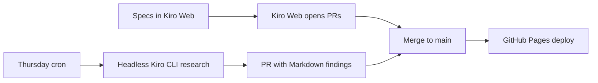

# Kiro New Features, Explained

The goal of this repo is to **explain, in simple terms, the new features of Kiro** across its four surfaces:

| Surface | What it is |
|---|---|
| **Kiro CLI** | Kiro in the terminal, including headless mode for CI/CD |
| **Kiro IDE** | The agentic IDE with specs, hooks and steering |
| **Kiro Web** | Kiro in the browser, creating specs and pull requests |
| **Kiro Crew** | Kiro agents working as a team |

Live site: https://san99tiago.github.io/aws-kiro-new-features/

## How this repo works



1. **Built with Kiro Web.** The project started as specs written in Kiro Web (see [`.kiro/specs/kiro-new-features-site/`](.kiro/specs/kiro-new-features-site)). Kiro Web then created the pull requests and keeps working autonomously to evolve the repo over time.
2. **Static site.** [`site/`](site) is plain HTML, CSS and JS. No framework.
3. **Weekly research.** Every Thursday at 12:00 UTC (7am Colombia), [`kiro-weekly-research.yml`](.github/workflows/kiro-weekly-research.yml) installs Kiro CLI, and runs four parallel headless sessions (CLI, IDE, Web, Crew) that read the official Kiro pages. Results are written to [`research/`](research) as Markdown and sent as a pull request.
4. **Publishing.** [`deploy-pages.yml`](.github/workflows/deploy-pages.yml) renders the reports into the site and deploys it to GitHub Pages when changes reach `main`.

## Layout

```
site/                      static website
research/                  weekly Markdown findings
src/run_kiro_research.py   parallel headless Kiro runner
scripts/build_site.py      renders research Markdown into the site
.github/workflows/         the two pipelines
.kiro/specs/               requirements, design, tasks
```

## Setup

1. Add the repository secret `KIRO_API_KEY` (Settings, Secrets and variables, Actions).
2. Enable Pages with Source set to **GitHub Actions** (Settings, Pages).
3. Allow Actions to create pull requests (Settings, Actions, General, Workflow permissions).
4. Run **Kiro weekly research** manually once with `workflow_dispatch`.

Local preview:

```bash
python3 scripts/build_site.py
python3 -m http.server -d site 8000
```

Headless mode reference: [Kiro CLI headless docs](https://kiro.dev/docs/cli/headless/). A similar CI/CD example: [aws-kiro-headless-demo-ci-cd](https://github.com/san99tiago/aws-kiro-headless-demo-ci-cd).

## License

Apache License 2.0. Copyright 2026 Santiago Garcia Arango. See [LICENSE](LICENSE).
